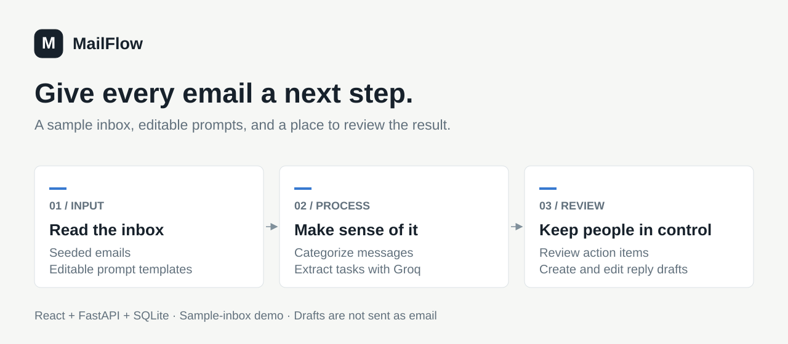
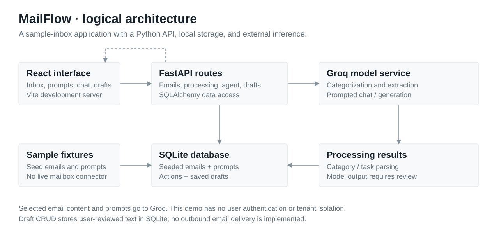

<div align="center">

# MailFlow

**Turn a sample inbox into a clearer list of next steps.**

Email categorization, action extraction, and editable drafts with prompts you control.

[Quick start](#run-locally) · [Architecture](#how-it-works) · [Development](#development) · [Contributing](#contributing)

</div>



MailFlow is a full-stack email productivity demo with a React interface, FastAPI backend, and SQLite database. Use its seeded inbox to explore how editable prompts turn email content into categories and action items, then review and save reply drafts.

**Project status:** portfolio prototype. The inbox is seeded sample data. There is no Gmail or Outlook connection, and saving a draft does not send an email.

## What you can do

- Categorize messages and extract tasks and deadlines with Groq.
- Create and edit prompts for categorization, action extraction, and replies.
- Ask questions about the inbox through a chat interface.
- Review and edit saved drafts before using them elsewhere.

## Run locally

Use Python 3.11+ and Node.js with npm. The backend needs your own Groq API key for AI features. The configured model is `llama-3.3-70b-versatile`; availability depends on your provider account.

```sh
git clone https://github.com/mukheshvadlamudi/MailFlow.git
cd MailFlow/email-productivity-agent
python -m venv .venv
```

Activate the environment with `.venv\Scripts\Activate.ps1` in PowerShell, or `source .venv/bin/activate` on macOS/Linux. Then:

```sh
python -m pip install -r requirements.txt
```

Create `email-productivity-agent/.env` with your own key:

```dotenv
GROQ_API_KEY=replace_with_your_key
LLM_MODEL=llama-3.3-70b-versatile
```

From `email-productivity-agent/`, start the API:

```sh
python -m uvicorn backend.main:app --reload --host 127.0.0.1 --port 8000
```

The API creates its SQLite tables and seeds sample emails and prompts on startup. Open [the API documentation](http://127.0.0.1:8000/docs) or check [health](http://127.0.0.1:8000/health).

Before starting the frontend, change `API_BASE_URL` in [frontend/src/lib/api.ts](frontend/src/lib/api.ts) to `http://localhost:8000`. The checked-in value points to a hosted instance; leaving it unchanged sends frontend requests there.

In a second terminal, from the repository root:

```sh
cd frontend
npm install
npm run dev -- --host 127.0.0.1
```

Open [http://localhost:8080](http://localhost:8080). Use `localhost` for the browser URL because that origin is included in the backend CORS configuration.

## How it works



[Editable Draw.io diagram](docs/assets/architecture.drawio) · [PNG version](docs/assets/architecture.png)

React calls the FastAPI routes. The backend loads sample emails and prompt templates from SQLite, calls Groq for AI processing, parses the results, and stores categories and action items. Draft routes separately create and update saved reply text; there is no outbound mail service.


The backend currently forces `LLM_PROVIDER=groq` in `backend/config.py`. Other provider settings exist but are not implemented as working alternatives in the service.

| Directory | Purpose |
| --- | --- |
| `email-productivity-agent/backend/api/routes/` | Inbox, prompts, processing, chat, and drafts |
| `email-productivity-agent/backend/services/` | Model calls and email processing |
| `email-productivity-agent/backend/database/` | SQLAlchemy models, connection, and sample data |
| `frontend/src/` | React interface and API client |

## Development

```sh
cd frontend
npm run build
npm run lint
```

No automated backend test suite is included. For a manual check, confirm the sample inbox loads, edit a prompt, process a message with your own key, and save a draft. Provider calls may incur charges.

## Limitations and data handling

This is a local demo without user authentication or tenant isolation. Email content and prompts used for AI processing are sent to Groq. Use sample data rather than confidential mail. Backend debug logging currently prints a prefix of the API key; remove that logging before sharing logs or deploying. Model output can be wrong and needs review.

## Contributing

Open an issue describing the problem and steps to reproduce it. Keep pull requests focused, include verification steps, and never include credentials, private emails, or generated databases. Useful next contributions include a configurable frontend API URL, backend tests, and safer logging.

## License

No project license is included. Public source availability does not itself grant an open-source license; reuse permissions need to be clarified by the owner.
